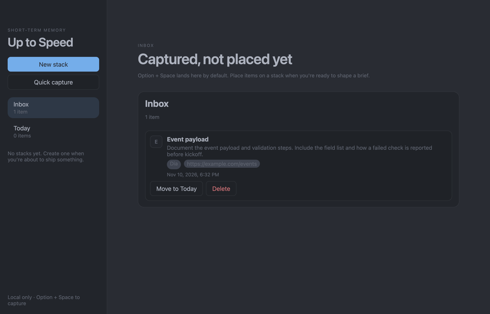
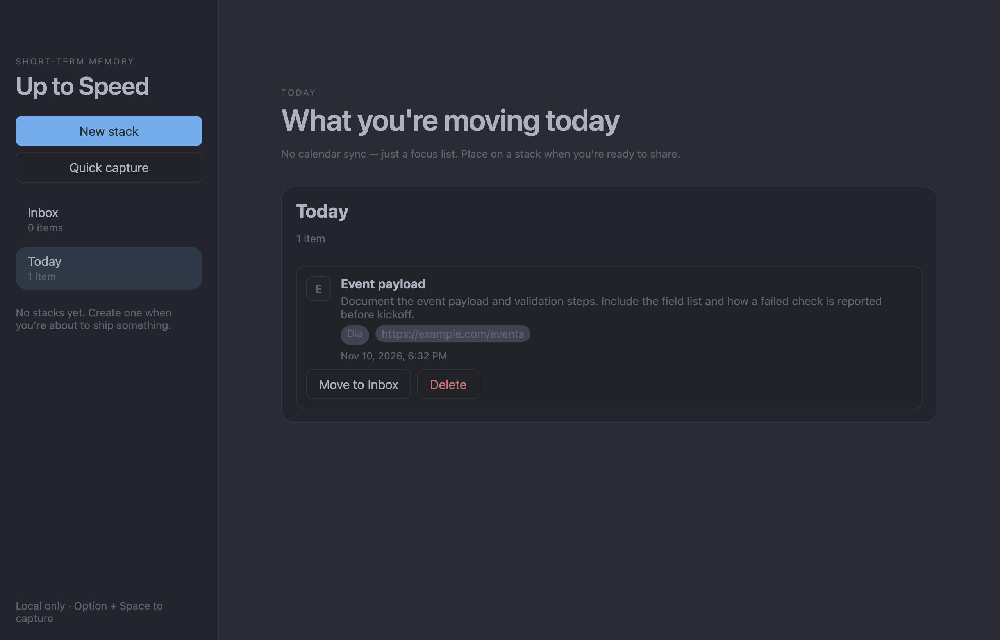
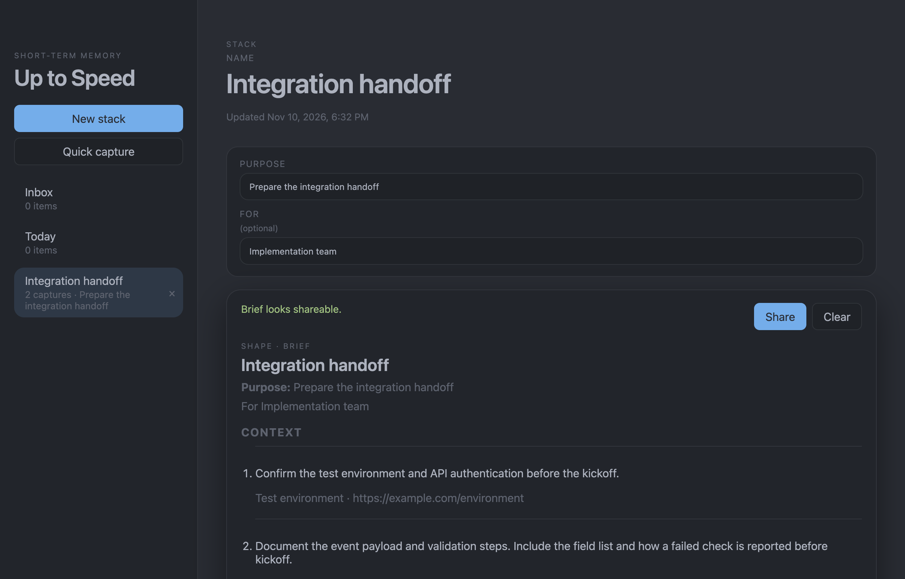

# Up to Speed

A local-first Mac app for capturing the context behind a link or window and turning it into one brief.

Version 0.7.3. This is source to inspect and build. This portfolio batch does not include an installer.

## The workflow

Capture a takeaway, keep it in Inbox or move it to Today, place it on a stack, and shape one brief. Copy the brief as Markdown or plain text, or save a `.md` file. Clear removes that stack after a confirmation. Sharing does not send the brief anywhere.







The screenshots use invented content from one isolated run on November 10, 2026. Quick capture saved “Event payload” with `https://example.com/events`. The list shows the longer note. The source chip is the app that was frontmost during that capture, Dia. A second capture, “Test environment” at `https://example.com/environment`, was added on the stack, and the Today item was placed under it.

## Design

- **Electron, TypeScript, and React.** Data is stored locally, with no account or app server. Website-icon lookup can send a captured URL’s hostname to external icon services or request the site’s favicon; the app is not strictly offline.
- **One brief shape.** A stack has a name, a purpose, and an optional recipient. Its ordered captures become one Markdown or plain-text brief.
- **Local file.** Schema version 5. Stacks live in `canvases[]`. Inbox and Today items live in `workObjects[]`. Loading an older file writes `up-to-speed.json.pre-v5-backup` once. An unreadable file is renamed to `up-to-speed.json.unreadable-<time>` before a new file is written.
- **Failure handling.** A slow site-icon lookup does not block a save indefinitely. Copy uses the app clipboard. A failed add keeps the typed text, a failed rename returns to the previous name, and Clear stays on its confirm step until the stack is actually gone.

## What was checked

In a November 10, 2026 Mac check of the dependency-updated copy, `npm test` passed 26 tests across 6 files and `npm run build` passed typechecking and produced a bundle. The tests cover brief output, stack warnings, capture construction and ordering, storage migration, and error messages. They do not open a window.

`npm run build` typechecks the Electron main process and the React UI, then writes the production bundle.

The screenshots came from an earlier, pre-dependency-update build launched with its own data directory:

```sh
./node_modules/.bin/electron --user-data-dir=/tmp/up-to-speed-demo "$PWD"
```

Run that from this directory. The `--user-data-dir=` flag needs the equals sign, and the last argument is this project. That launch created the three screenshots above: Quick capture into Inbox, a longer note in Object Detail, Move to Today, a new stack, a manual capture, and placing the Today item on the brief.

That screenshot launch did not check Option+Space, the blurred backdrop, or the save-file dialog. In the later dependency-updated copy, a separate isolated Mac check exercised all three: the shortcut opened capture, the blurred backdrop was observed, and the native save panel wrote an invented brief to a Markdown file. The app confirmed the save.

An earlier isolated run, before the dependency update, also exercised failed saves, copy, Clear, and an unreadable data file. Those cases were not repeated in the later check.

## Dependency status

On November 10, 2026, `npm audit` on this dependency-updated copy reported six moderate findings linked to one [minimatch denial-of-service advisory](https://github.com/advisories/GHSA-g3hv-75wg-m249) in the electron-builder packaging dependency chain. No high or critical findings were reported. The proposed automatic fix was a builder downgrade, which was not applied. These are dependency findings, not evidence of an exploit in this app.

## Run it

On a Mac, from this directory:

```sh
npm ci
npm test
npm run build
./node_modules/.bin/electron --user-data-dir=/tmp/up-to-speed-demo "$PWD"
```

`npm run dev` and `npm start` use the app’s normal data file, `~/Library/Application Support/up-to-speed/up-to-speed.json`. The name comes from the app, so a second copy on the same Mac uses that same file. Use `--user-data-dir=` when an everyday copy already has saved data.

## Boundaries

No calendar sync, no Slack, Jira, or Notion APIs, and no tags, global search, cloud sync, or AI summarization. This is a personal project, not a customer deployment.

## License

[MIT](LICENSE).
